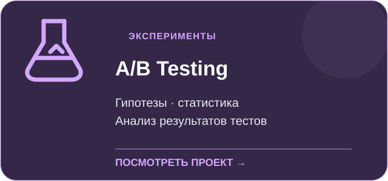

<h2 align="center">Мой стек</h2>

  
  
  
  
  
  
  

<h2 align="center">Мои проекты</h2>

<table>
  <tr>
    <td width="50%">
      
    </td>
    <td width="50%">
      
    </td>
  </tr>
  <tr>
    <td width="50%">
      
    </td>
    <td width="50%">
      
    </td>
  </tr>
</table>

<h2 align="center">Методы анализа</h2>

RFM-анализ · Когортный анализ · EDA · A/B-тестирование

Рада новым интересным аналитическим задачам ✨

